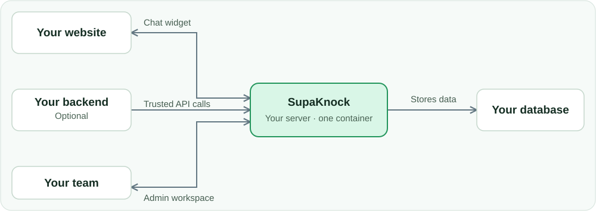

<p align="center">
  <a href="https://supaknock.com"></a>
</p>

<h1 align="center">SupaKnock</h1>

<p align="center"><strong>Support for your app. On your server.</strong></p>
<p align="center">Customer chat, feedback boards, and forms for app makers and small teams.</p>

<p align="center">
  <a href="https://supaknock.com">Website</a> ·
  <a href="#quick-start">Install</a> ·
  <a href="#your-first-chat-message">Try chat</a> ·
  <a href="https://supaknock.com/api-docs">API guide</a> ·
  <a href="docs/README.md">Documentation</a> ·
  <a href="https://supaknock.com/iphone">iPhone preview</a>
</p>

<p align="center">
  <a href="LICENSE"></a>
  <a href="https://hub.docker.com/r/taylorarronj/supaknock"></a>
  <a href="docs/database-providers.md"></a>
</p>

---

SupaKnock gives your team one place to reply to customers, review ideas, and collect submissions. Add chat to your website, share a feedback board, or connect your own app through the API.

Run it in a single Docker container. SQLite works out of the box, with PostgreSQL and Supabase available when you need them. The core application needs no hosted SupaKnock account, email provider, Redis, or AI subscription.

**For example:** you run a SaaS app. Customers ask for help through a chat bubble, suggest and vote on features on a feedback board, and join your beta through a form. Your team replies to messages, reviews ideas, and reads form answers in its SupaKnock workspace.

One installation can serve multiple **projects**—one for each app or product. Each project has its own chat settings, boards, forms, and integration credentials.

**[Explore SupaKnock →](https://supaknock.com)**

## How it fits into your app



The widget talks directly to your SupaKnock server. For integrations that act as your signed-in users, your backend verifies the user and makes the trusted API calls. **Project secrets stay on your backend**; browser chat uses a separate, limited chat credential. Your team signs in to SupaKnock to reply and manage projects.

## Pick your first integration

| I want to… | Start here | Do I need my own backend? |
| --- | --- | --- |
| **Add customer chat** | Enable website chat and paste a small HTML snippet. [Try it below →](#your-first-chat-message) | **No** for anonymous website chat. **Yes** to connect your existing signed-in users. |
| **Collect feature requests** | Create a board and share its SupaKnock link. [Feedback guide →](docs/integration.md) | **No** for built-in pages; participants sign in to SupaKnock. **Yes** for participation through your app's own users and interface. |
| **Collect form submissions** | Create a form and enable its hosted public page, or its website embed. [Forms guide →](docs/forms.md) | **No** for hosted pages or enabled embeds. **Yes** for the backend token API. |

<details>
<summary><strong>See customer screens and an administrator preview</strong></summary>

| Website chat | Feedback in your own app |
| --- | --- |
| <a href="https://supaknock.com/assets/showcase/glean-chat.jpg"></a> | <a href="https://supaknock.com/assets/showcase/glean-feedback.jpg"></a> |
| The embeddable chat widget, styled for Glean. This example has optional AI enabled. | Glean's custom feedback interface, built on the SupaKnock API. |

Your team manages conversations in the web **Live chat** inbox. The **upcoming iPhone companion** provides another way to manage them; this preview shows sample data:

<p align="center"><a href="https://supaknock.com/iphone"></a></p>

[Explore the web product preview](https://supaknock.com/#product) or [see more integrations](https://supaknock.com/examples). Screenshots are hosted on the product website; the iPhone companion is coming soon.

</details>

## A small support desk, with room to grow

| | What you can do |
| --- | --- |
| **Customer chat** | Embed a chat widget, reply from a shared inbox, and support anonymous visitors or authenticated customers. [Chat guide →](docs/chat.md) |
| **Feedback boards** | Review requests before publishing, collect votes, and track ideas from consideration to shipped. [Feedback guide →](docs/integration.md) |
| **Forms** | Collect submissions through your backend or an explicitly enabled public form link. Answers stay private to administrators. [Forms guide →](docs/forms.md) |
| **AI support, optional** | Answer from approved knowledge, choose your provider, and enable individual tools. AI starts off. [AI guide →](docs/ai-providers.md) |
| **Connected apps** | Read customer profiles, recent signups, and activity from your app alongside support history. [Connection guide →](docs/connected-apps.md) |
| **API and webhooks** | Build your own experience with a versioned JSON API and signed webhook deliveries with retries. [API guide →](https://supaknock.com/api-docs) |

Shared notifications and configurable business hours help your team follow up. An optional iPhone companion is **coming soon**; [preview it and request early access](https://supaknock.com/iphone). Its push relay is packaged separately.

## Quick start

### 1. Use the published Docker Hub image

The prebuilt application image is **[`taylorarronj/supaknock:latest` on Docker Hub](https://hub.docker.com/r/taylorarronj/supaknock)**. Its full image address is `docker.io/taylorarronj/supaknock:latest`, with builds for AMD64 and ARM64. You can run it without cloning this repository or building the application yourself.

Install [Docker with Compose](https://docs.docker.com/compose/install/), then create a **new installation directory**:

```sh
mkdir supaknock
cd supaknock
```

### 2. Create `compose.yaml`

Save the following as `compose.yaml` in that directory. The `image` line tells Docker Compose to pull the published image from Docker Hub. The named volume keeps your SQLite database and generated secrets across container restarts and upgrades.

```yaml
name: suggestionbox

services:
  supaknock:
    image: taylorarronj/supaknock:latest
    restart: unless-stopped
    ports:
      - "127.0.0.1:8000:8000"
    environment:
      PUBLIC_BASE_URL: http://localhost:8000
      COOKIE_SECURE: "false"
      DATABASE_PROVIDER: sqlite
      DATABASE_URL: sqlite:///data/feedback.sqlite
    volumes:
      - feedback_data:/data
    stop_grace_period: 20s
    security_opt:
      - no-new-privileges:true
    cap_drop:
      - ALL
volumes:
  feedback_data:
```

This is the same configuration as [compose.image.yaml](compose.image.yaml). It runs locally at `http://localhost:8000`; see [Put it on your domain](#put-it-on-your-domain) before exposing it publicly.

### 3. Pull the image and start SupaKnock

Run these commands from the directory containing `compose.yaml`:

```sh
docker compose pull supaknock
docker compose up -d supaknock
docker compose ps
```

The first command downloads `taylorarronj/supaknock:latest` from Docker Hub. The second starts it in the background. Wait for `docker compose ps` to show the service as **healthy** before continuing.

### 4. Read `setup.token` and create your administrator

On first startup, SupaKnock generates a private setup token at `/data/setup.token` inside the container. Read it with:

```sh
docker compose exec supaknock cat /data/setup.token
```

Copy the printed token, open **[http://localhost:8000/setup](http://localhost:8000/setup)**, and enter it with the email and password for your first administrator account. Keep the token private. If you explicitly set a `SETUP_TOKEN` environment variable, use that value instead of the generated file.

Setup closes permanently after the first administrator is created. For later visits, sign in at **[http://localhost:8000/login](http://localhost:8000/login)** with your administrator email and password; you do not need the setup token again.

From the workspace, create a project, add a feedback board, enable website chat, or create a form. Share direct board and project links so visitors can read published feedback; participants sign in to submit ideas or vote.

### Put it on your domain

Set `PUBLIC_BASE_URL` to your HTTPS origin and `COOKIE_SECURE` to `"true"`, then put an HTTPS reverse proxy in front of port 8000. Set `TRUSTED_PROXY_IPS` to the addresses of the proxies you actually trust.

Run **one application instance** and preserve its volume and encryption key. For an existing installation, retain its Compose project name and volume; changing those can select an empty volume. Never use `docker compose down -v` to upgrade.

See [configuration](docs/configuration.md), [PostgreSQL and Supabase setup](docs/database-providers.md), and [backups, recovery, and upgrades](docs/operations.md).

## Your first chat message

After the [Docker quickstart](#quick-start), try a complete customer-to-team conversation. This example uses anonymous chat with AI off and needs no API key or custom backend.

### 1. Create a project and enable chat

In the administrator workspace, open **Overview → Create project**. Use `demo` as the identifier and `Demo app` as the name.

Open that project's **Website chat** settings, check **Enable website chat**, add `http://localhost:3000` under **Allowed website origins**, and choose **Save chat settings**. Use that exact origin, with no trailing slash. Leave AI support off.

### 2. Add the widget to a test page

Create a separate `demo-site` directory and save this as its `index.html`:

```html
<!doctype html>
<html lang="en">
  <head>
    <meta charset="utf-8">
    <meta name="viewport" content="width=device-width, initial-scale=1">
    <title>My app — support demo</title>
  </head>
  <body>
    <h1>Welcome to my app</h1>
    <p>Open the chat bubble to send our team a message.</p>

    <div id="suggestion-box-chat"></div>
    <script defer src="http://localhost:8000/widget.js"
      data-server="http://localhost:8000"
      data-project="demo"
      data-target="#suggestion-box-chat"></script>
  </body>
</html>
```

The server URL is your SupaKnock installation; `data-project` is the project's identifier. For other installations, copy the generated snippet from that project's **Website chat** settings.

### 3. Open the page and send a message

Serve `demo-site` with your development server on port 3000. If you have Python 3 installed, run this **from inside `demo-site`**:

```sh
python3 -m http.server 3000 --bind 127.0.0.1
```

Visit **[http://localhost:3000](http://localhost:3000)**, open the chat bubble, and send **“Hello from my app!”** Use the HTTP address above rather than opening the HTML file directly. Keep this browser tab open.

### 4. Reply from your workspace

In another tab, sign in to **[http://localhost:8000/login](http://localhost:8000/login)** as your administrator. Open **Live chat**, select the new conversation, and reply **“Hi! How can we help?”**

Return to your demo page: the reply appears in the widget. You now have a working support conversation between your website and your own SupaKnock installation.

If chat does not appear, check that the project identifier is `demo`, website chat is enabled, and the page is opened at the allowed origin `http://localhost:3000`. `127.0.0.1:3000` is a different origin. See [widget setup and website security](docs/chat.md#add-the-widget) for CSP rules, appearance options, and production HTTPS setup.

## Make it part of your app

Use the built-in widget and pages, or build your own interface against `/api/v1`. Backend project credentials stay on your server. SupaKnock keeps your user IDs opaque and scoped to each project; an external user ID is never a credential.

- **Website chat:** [install the widget and connect authenticated customers](docs/chat.md).
- **Feedback and votes:** [integrate with your backend](docs/integration.md).
- **Forms:** [submit from your backend or enable a hosted public page](docs/forms.md).
- **Events:** [verify signatures and handle webhook retries](docs/webhooks.md).
- **AI tools:** [connect approved public, read-only MCP services](docs/mcp-tools.md).

Read the **[online API guide](https://supaknock.com/api-docs)** or use the [OpenAPI schema](docs/openapi.json). Every running installation also serves its schema at `/api/v1/openapi.json`.

## Built to keep you in control

New feedback stays private until accepted. Form answers and administrator views are private. Public links expose published feedback, with no public installation-wide project directory.

AI support, assistant tools, and public form pages are opt-in. Local knowledge search uses EmbeddingGemma, with weights downloaded only after an administrator explicitly requests them. External AI and embedding providers receive the data needed for their enabled features; [review the setup and data flow](docs/ai-providers.md) before activating them.

Your application records stay in your installation database. Backups include the encryption key needed to restore encrypted settings. [Read the operations guide →](docs/operations.md)

## Common questions

**Does this work with my existing users?**

Yes. Your backend authenticates your users and passes their exact project-scoped IDs. For authenticated customer chat, it exchanges its project credential for a short-lived customer chat credential. The default widget is anonymous and does not automatically inherit your app's login. [Authenticated chat →](docs/chat.md#integrate-authenticated-customers)

**Do customers need another account?**

Anonymous chat and public or embedded forms need no account. Built-in feedback pages require a SupaKnock participant account to submit or vote. A custom backend integration can let your users participate through their existing app accounts. An email submitted in a form or chat does not create or link an account.

**Will this work with my framework or a native app?**

The chat and form widgets use plain JavaScript and HTML. A React, Vue, or other client-rendered site can use the documented manual mounting options. Your backend and custom native interfaces can use the JSON API; there is no required frontend framework. [Chat mounting](docs/chat.md#match-your-website) · [Form embedding](docs/forms.md#embed-a-form-in-your-website) · [API guide](https://supaknock.com/api-docs)

**Is AI required?**

No. Human chat, feedback boards, and forms work with AI disabled. AI support, provider credentials, knowledge sources, and tools are configured separately and explicitly enabled.

**Where does the data live, and what leaves my server?**

Application records live in your chosen SQLite, PostgreSQL, or Supabase database. Enabled external AI providers receive the context needed to answer; external embedding providers receive approved passages and search questions. Configured webhooks send event payloads to your receiver; optional push uses a separate relay for generic alerts. Connected apps and MCP tools make requests to the services you configure. Read the [AI](docs/ai-providers.md), [webhook](docs/webhooks.md), [push](docs/push.md), and [MCP tool](docs/mcp-tools.md) guides before enabling those integrations.

**Is the iPhone app included in this Docker image?**

No. The image contains the web application and API. The optional iPhone administrator companion is coming soon and connects to your server; its source and push relay are maintained separately. [iPhone preview →](https://supaknock.com/iphone)

## Develop locally

This repository contains the application, its API, migrations, tests, and Docker build. The product website, iPhone source, and optional push relay are maintained separately. You can build and run the application from this repository alone.

To build the container from source:

```sh
cp .env.example .env
docker compose up -d --build
```

For Python development, use Python 3.12+ and patched SQLite (3.51.3+ or a vendor backport of the WAL-reset fix):

```sh
python3 -m venv .venv
.venv/bin/pip install -r requirements.lock
.venv/bin/pip install -e '.[test]'
.venv/bin/python -m pytest -q

# Use an absolute path for your local database.
DATABASE_URL=sqlite:///absolute/path/to/data/feedback.sqlite .venv/bin/python -m feedback
```

The Python server reads process environment variables; it does not automatically load `.env`. Optional local AI dependencies have [separate setup instructions](docs/ai-runtime.md).

Start with the [architecture](docs/architecture.md), [development boundaries](AGENTS.md), and [documentation index](docs/README.md). See [verification](docs/verification.md) for completed checks and known test failures, and [progress](PROGRESS.md) for current work. This checkout may contain changes newer than a published Docker image.

## License

[MIT](LICENSE). Self-host it, adapt it, and build it into your own products.

<p align="center"><a href="https://supaknock.com">supaknock.com</a></p>
